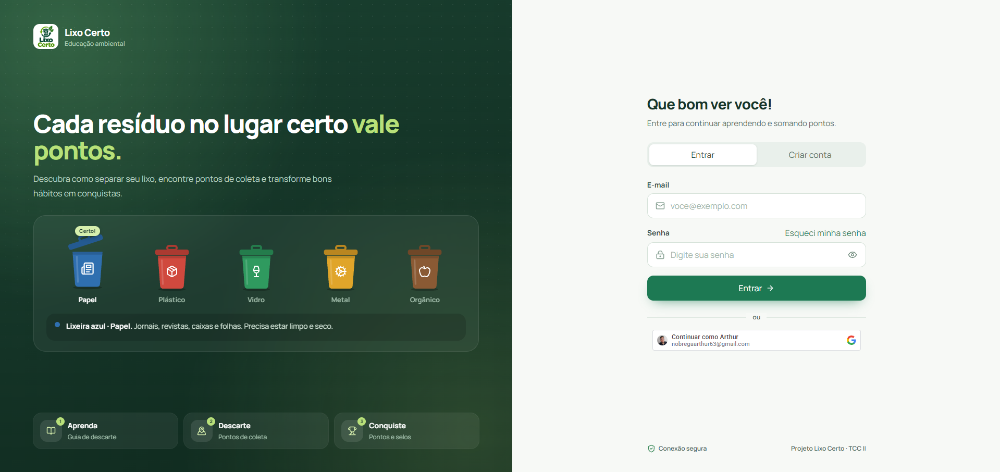

# LixoCerto

## Plataforma digital de educação ambiental e apoio ao descarte responsável de resíduos

**Projeto acadêmico aplicado — Trabalho de Conclusão de Curso II** 
**Contexto de aplicação:** João Pessoa, Paraíba

O LixoCerto é uma aplicação web concebida para apoiar a tomada de decisão sobre separação, preparo e encaminhamento de resíduos. A solução organiza, em uma mesma interface, orientações educativas, consulta a pontos de coleta cadastrados e recursos de aprendizagem. Seu propósito é aproximar informação ambiental e ação cotidiana, sem substituir os serviços municipais, os operadores de coleta ou a confirmação local das condições de recebimento.

A proposta dialoga com os objetivos de gestão integrada da Política Nacional de Resíduos Sólidos e com sua articulação com a Política Nacional de Educação Ambiental. A PNRS inclui a responsabilidade compartilhada pelo ciclo de vida dos produtos entre seus princípios. Como ferramenta digital de apoio, o sistema oferece recursos informacionais e de registro; a existência de uma funcionalidade, por si só, não demonstra mudança de comportamento ou impacto ambiental mensurado.

[**Acessar a versão web em homologação**](https://centrallixocerto.com.br/)

## Interface da aplicação

Captura da interface de autenticação da versão web de homologação.

## Escopo funcional

- **Guia de descarte:** consulta por material, com orientações de preparo, cuidados, encaminhamentos possíveis e fontes de referência.
- **Pontos de coleta:** consulta a locais cadastrados e às informações disponíveis sobre recebimento.
- **Aprendizagem:** questionários, desafios e acompanhamento de progresso para apoiar a educação ambiental.
- **Registro de descarte:** fluxo de check-in com localização e fotografia, sujeito às regras de validação da plataforma.

## Exemplo do Guia de descarte

  
  

Capturas reais do Guia no ambiente público de homologação. As regras de recebimento variam conforme o município e o operador; confirme disponibilidade, endereço e horário antes de se deslocar.

## Organização técnica

A interface web é a camada de acesso do usuário. A API centraliza as regras de negócio e coordena módulos internos; o navegador não acessa diretamente esses módulos. As integrações externas são encapsuladas em um componente próprio. A implementação utiliza React, TypeScript e Vite no frontend; NestJS e gRPC na API; PostgreSQL e Redis para persistência e apoio operacional; Envoy para gRPC-Web; e Docker para conteinerização.

## Referência normativa

BRASIL. Lei nº 12.305, de 2 de agosto de 2010. Institui a Política Nacional de Resíduos Sólidos. [Texto oficial](https://www.planalto.gov.br/ccivil_03/_ato2007-2010/2010/lei/l12305.htm).
