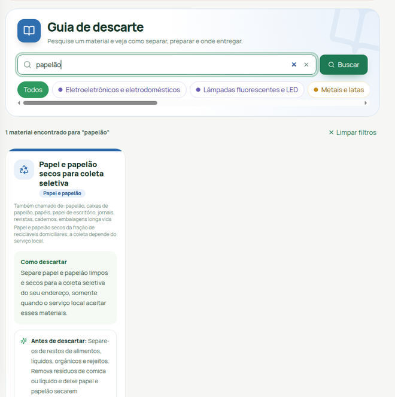
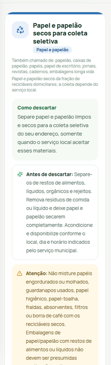

# LixoCerto

**Informação clara para apoiar o descarte responsável.**

O LixoCerto é uma plataforma web de educação ambiental que reúne orientações de descarte, consulta a pontos de coleta e atividades educativas. O projeto tem foco em apoiar a população de João Pessoa, PB, a encontrar informações práticas para encaminhar resíduos com mais segurança.

[**Acessar a versão web de homologação**](https://centrallixocerto.com.br/)

## O que você encontra

- **Guia de descarte:** orientações de preparo, cuidados e encaminhamento, com indicação de fontes.
- **Pontos de coleta:** consulta a locais cadastrados e às informações disponíveis sobre recebimento.
- **Aprendizagem:** quizzes, desafios e acompanhamento de progresso.
- **Check-in de descarte:** registro com localização e foto, sujeito às regras de validação da plataforma.

## Conheça o Guia

  
  

Capturas reais do Guia no ambiente público de homologação: busca e ficha de papel/papelão. As regras de recebimento variam por município e operador. Confirme a disponibilidade, o endereço e o horário diretamente com o local antes de se deslocar.

## Como o projeto é organizado

A aplicação combina uma interface web, uma API e serviços de infraestrutura conteinerizados. O código-fonte é mantido nos repositórios da organização.
